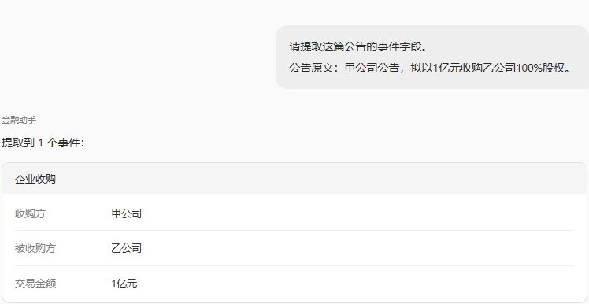

# Qwen3-0.6B 金融事件抽取

用 Qwen3-0.6B 和一套 LoRA，从中文金融公告中识别企业收购、股份回购，输出事件类型与核心字段。数据来自 DuEE-Fin，训练集 800 条。基座与微调模型使用同一套提示词，在 125 条固定测试数据上评估。

仓库保留数据划分、基座、最终适配器、实验报告，以及本地模型服务、业务后端和聊天页面。

## 页面效果

示例使用虚构公告：“甲公司公告，拟以1亿元收购乙公司100%股权。”页面将模型输出的 JSON 展示为事件和字段。



页面采用黑白灰配色，包含消息输入、抽取结果、新建对话和连接状态。[桌面首页](docs/images/chat-home.png) · [手机页面](docs/images/financial-extraction-mobile.png)

## 数据与训练

数据来自 [DuEE-Fin 镜像](https://huggingface.co/datasets/hccngu/Viscacha-Chinese-IE/tree/main/DuEE-fin)。从原始数据中选择企业收购、股份回购和非目标事件，按类别冻结划分。

| 集合 | 企业收购 | 股份回购 | 非目标事件 | 合计 |
| --- | ---: | ---: | ---: | ---: |
| 训练集 | 320 | 320 | 160 | 800 |
| 验证集 | 40 | 40 | 20 | 100 |
| 测试集 | 50 | 50 | 25 | 125 |

企业收购抽取收购方、被收购方、交易金额；股份回购抽取回购方、回购股份数量、交易金额。非目标事件输出 `{"events": []}`。

| 训练项 | 设置 |
| --- | --- |
| 原始模型 | Qwen/Qwen3-0.6B |
| 微调方式 | PEFT LoRA，一套适配器同时学习事件类型与字段 |
| LoRA 设置 | Rank 8，Alpha 16，Dropout 0.05，注入 q_proj、v_proj |
| 训练数据 | 全部 800 条训练样本 |
| 训练轮数 | 3 轮，150 个优化步 |
| 学习率 | 2e-5 |
| 有效 batch size | 16，单设备 batch 1，梯度累积 16 |
| 序列长度 | 2048 Token |
| 训练精度 | BF16 |
| GPU | NVIDIA GeForce RTX 3080 10GB |
| 最终检查点 | checkpoint-150，按验证集指标选择 |

LoRA 权重为 4,602,248 字节，与原始基座分别保存。推理时加载基座，再挂载适配器。

## 测试结果

两组使用相同的 125 条测试数据、system/user 提示、非 thinking 模式和贪心解码，最多生成 256 Token。

| 指标 | 原始 Qwen3-0.6B | 基座加载 LoRA |
| --- | ---: | ---: |
| 严格字段 micro-F1 | 0 | 0.6944 |
| 文档完全正确率 | 0% | 45.6% |
| JSON 协议合法率 | 0% | 98.4% |

字段按 `(事件类型, 字段名, 字段值)` 精确匹配。原模型存在 Markdown 围栏、字段结构等协议错误，严格评分计为失败；表中的 0 分反映该协议下的结果。微调模型在 25 条负样本中误报 15 条，字段边界与非目标事件拒识仍是主要错误来源。

以上为冻结子集上的实验结果，完整训练设置、评分规则与结果见[实验报告](完整实验报告.md)。逐条预测保存在[测试集评估明细](测试集评估明细.json)。页面截图展示单条样例，不作为测试指标。

## 项目结构

```text
data/
  raw/DuEE-fin/                  原始数据与来源哈希
  processed/two_events_v1/        训练集、验证集、测试集及分组清单
models/
  Qwen3-0.6B/                    原始基座与分词器
  Qwen3-0.6B-financial-LoRA/      checkpoint-150 适配器
model_service/                   模型加载、聊天推理、抽取协议校验
backend/                         意图识别与 LangGraph 对话编排
frontend/                        HTML/CSS/JavaScript 页面及本地静态服务
docs/                           实践文章与页面截图
完整实验报告.md
测试集评估明细.json
```

原训练脚本和中间优化器状态未保留，训练参数、loss 记录、检查点选择和测试结果保存在实验报告中。仓库中的可执行代码覆盖部署与推理。

## 本地运行

本地验证环境为 Windows、i5-14400F、16GB 内存。模型采用 CPU FP32 推理，默认 6 个计算线程。三个服务各自使用 uv 管理 Python 3.11 环境与锁定依赖。

先安装 [Git LFS](https://git-lfs.com/) 和 [uv](https://docs.astral.sh/uv/)，再获取仓库：

```powershell
git lfs install
git clone https://github.com/shuimqy/qwen3-lora-financial-events.git
cd qwen3-lora-financial-events
git lfs pull
```

在项目根目录安装三个环境：

```powershell
powershell -NoProfile -ExecutionPolicy Bypass -File .\model_service\scripts\setup.ps1
powershell -NoProfile -ExecutionPolicy Bypass -File .\backend\scripts\setup.ps1
powershell -NoProfile -ExecutionPolicy Bypass -File .\frontend\scripts\setup.ps1
```

启动：

```powershell
powershell -NoProfile -ExecutionPolicy Bypass -File .\frontend\scripts\start_all.ps1
```

| 服务 | 地址 |
| --- | --- |
| 页面 | http://127.0.0.1:3000 |
| 后端 API 文档 | http://127.0.0.1:8000/docs |
| 模型 API 文档 | http://127.0.0.1:8001/docs |

模型加载完成后，页面右上角显示“可用”。停止：

```powershell
powershell -NoProfile -ExecutionPolicy Bypass -File .\frontend\scripts\stop_all.ps1
```

## 调用流程

```text
浏览器 → frontend /api 代理 → backend /v1/chat
                                  ↓
                         规则判断与基座分类
                          ├─ 普通聊天 → 基座
                          ├─ 事件抽取 → 基座 + LoRA
                          └─ 澄清     → 后端直接返回问题
```

模型服务只加载一份基座。基座模式在生成锁内临时禁用 LoRA，生成后恢复；抽取固定启用 LoRA。前端不直接访问模型接口。

抽取示例：

```text
请提取这篇公告的事件字段。

公告原文：甲公司公告，拟以1亿元收购乙公司100%股权。
```

独立接口、配置项和检查命令见[模型服务](model_service/README.md)、[业务后端](backend/README.md)和[前端](frontend/README.md)。

## 当前边界

- 核心功能为单次金融公告抽取与独立聊天。API 接收对话历史，页面保留消息与当前原文。
- 字段追问尚未接入普通聊天。询问上次交易的金额会进入完整抽取分支，再次返回整套字段。
- 开发测试已复现历史错误回复干扰后续聊天。多轮任务切换尚未完成。
- 抽取字段存在边界错误、遗漏和负样本误报。合法 JSON 只表示协议通过。
- 输入与预留输出合计上限为 2048 Token；超限返回错误，不截断公告。
- 云端测试采用 GPU BF16，本地服务采用 CPU FP32；本地部署检查与原始测试指标分别记录。

## 来源

基座为 [Qwen/Qwen3-0.6B](https://huggingface.co/Qwen/Qwen3-0.6B)，是官方后训练模型。本项目中的“基座”指尚未接受本项目 LoRA 微调的原模型。原模型许可保存在[模型目录](models/Qwen3-0.6B/LICENSE)。

数据来源与原始文件 SHA-256 保存在 [source_manifest.json](data/raw/DuEE-fin/source_manifest.json)。模型与数据沿用各自来源的许可。项目过程见[实践文章](docs/qwen3-lora-practice.md)。
