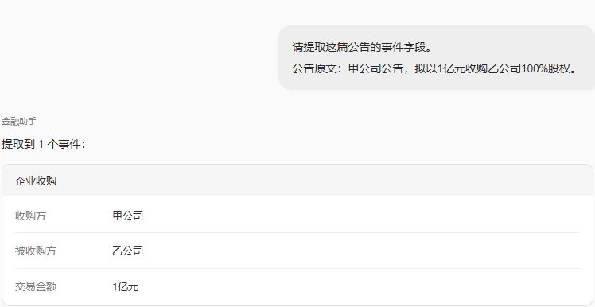

# 金融助手前端

HTML、CSS 和原生 JavaScript 实现的单页聊天界面，采用黑白灰配色。页面包含消息输入、字段卡片、等待与错误提示、新建对话和连接状态。



## 运行

前端的独立 uv 环境运行本地静态服务，不依赖 Node 构建。以下命令从项目根目录执行：

```powershell
powershell -NoProfile -ExecutionPolicy Bypass -File .\frontend\scripts\setup.ps1
powershell -NoProfile -ExecutionPolicy Bypass -File .\frontend\scripts\start_all.ps1
```

`start_all.ps1` 依次启动模型服务、后端和前端，前提是三个目录已分别完成 setup。页面地址为 http://127.0.0.1:3000，模型就绪后右上角显示“可用”。

一并停止：

```powershell
powershell -NoProfile -ExecutionPolicy Bypass -File .\frontend\scripts\stop_all.ps1
```

`frontend/scripts/start.ps1` 与 `stop.ps1` 单独管理前端。在 `frontend/` 中执行 `uv run --frozen financial-frontend` 启动前台服务。

## 交互

- Enter 发送，Shift + Enter 换行，支持中文输入法选字。
- 等待回复期间禁用重复发送。请求失败保留草稿，失败消息不加入请求历史。
- 抽取成功展示字段卡片；空事件、无效输出、输出截断分别显示提示。
- 新对话清空消息、当前公告和待补原文状态。刷新页面同样清空。
- 历史与 `context` 只保存在页面内存，没有登录、数据库或浏览器持久化。

抽取输入示例：

```text
请提取这篇公告的事件字段。

公告原文：甲公司公告，拟以1亿元收购乙公司100%股权。
```

本例为虚构公告。截图使用已保存的模型响应展示字段布局。

API 接收历史与补发原文，但多轮字段追问和跨任务切换尚未完成，具体行为见[后端说明](../backend/README.md)。当前页面验证范围为单次公告抽取与独立聊天。

## 服务连接

```text
浏览器 :3000 → /api 代理 → backend :8000 → model_service :8001
```

前端只请求 `/api/v1/chat` 与 `/api/health/ready`。`src/financial_frontend/server.py` 托管静态文件并代理这两个固定路径，不包含意图识别或模型推理。

本地服务从终端环境读取配置，`.env.example` 列出变量，本服务不自动加载 `.env`：

```powershell
$env:FRONTEND_PORT = '3000'
$env:FRONTEND_BACKEND_URL = 'http://127.0.0.1:8000'
```

服务器部署使用 Nginx 托管 `static/`，将 `/api/` 转发到业务后端。后端连接模型的地址由 `BACKEND_MODEL_SERVICE_URL` 配置。

## 检查

在 `frontend/` 执行：

```powershell
uv run --frozen pytest
node --check static/app.js
uv run --frozen python scripts/check_browser.py
```

Node 只用于 JavaScript 语法检查。浏览器检查使用已安装的 Microsoft Edge，不下载浏览器，执行前启动三个服务。

2026-11-16，3 项代理检查和 Edge 浏览器检查通过。检查内容包括补充原文后抽取、基座聊天、失败保留草稿、新对话清理上下文和 HTML 纯文本展示。桌面与 390px 手机页面无横向溢出，未出现页面脚本错误。原始响应与截图写入 `run/`，该目录不提交。
